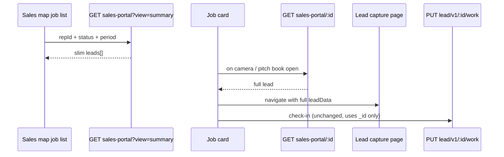

# Sales Portal API Optimization

This document describes the sales-portal list optimization: **slim list for map job cards** + **full lead on open**, without breaking the portal or the existing default list API.

---

## Problem

`GET /demo/v1/leads/sales-portal` returned a **fully hydrated lead object for every row** (photos, job builder, installer, office/region trees, action logs, reports, etc.). The sales map Self Gen / Issued / Archive tabs only need card fields, so the list payload was unnecessarily large.

---

## What changed vs what stayed the same

| Item | Before | After |
|------|--------|-------|
| List API without `view=summary` | Full fat list + `summaryCounts` | **Unchanged** (portal, legacy callers) |
| `view=summary` query param | Did not exist | **New** — sales map only |
| `GET /leads/sales-portal/:id` | Did not exist | **New** — one full lead on open |
| `PUT /lead/v1/:id/work` | Check-in by lead `_id` | **Unchanged** |
| `leadId` on list query string | Ignored | Still **ignored** (use `/:id` for one lead) |

---

## Three API calls (quick reference)

| Call | Who uses it | Response |
|------|-------------|----------|
| `GET /demo/v1/leads/sales-portal?repId=…` (no `view`) | Portal, NP, legacy | Full `leads[]` + real `summaryCounts` |
| `GET /demo/v1/leads/sales-portal?repId=…&view=summary` | Sales map job list | Slim `leads[]` + `summaryCounts: null` |
| `GET /demo/v1/leads/sales-portal/:id` | Open one lead (capture, pitch book, etc.) | `{ lead }` — one full object |

---

## Why `view=summary`?

**It did not exist before.** We added it in this optimization.

The sales map only displays card fields (name, address, date, time, status, map pin). Without `view=summary`, the list API loaded job builder, all photo arrays, installer data, etc. for **every** lead — even though the UI never shows that on the list.

- Sales app `useGetLeads` adds `view=summary` automatically.
- Portal and anything that **omits** `view=summary` gets the same full response as before.

---

## Why is `summaryCounts` null on `view=summary`?

**`summaryCounts` existed before** on the **full** list API. It is computed from photo arrays and GPS coordinates on each lead (`photosCaptured`, `avgPhotosPerJob`, `gps-check-ins`, etc.). See `sale-portal-api-response.txt` for the old shape.

On `view=summary`:

- We **do not load** full photo data (by design — that is the optimization).
- We **cannot** compute accurate `summaryCounts`, so the handler returns `"summaryCounts": null`.
- **Sales frontend does not use `summaryCounts`** (no references in sales or portal frontends for this API).
- The **full** list (no `view=summary`) still returns a real `summaryCounts` object, same as before.

You do **not** need `summaryCounts` for the Self Gen / Issued / Archive job list.

---

## API reference

### 1. List API (existing)

**Method:** `GET`  
**Auth:** `Authorization: Bearer <JWT>`  
**Body:** None

#### Example — full list (portal / default)

```
GET https://api.np.revdsm.com/demo/v1/leads/sales-portal?repId=69b107a903e4f7bfda22f43a
```

Optional filters: `status`, `period`, `regionId`, `officeId`, `leadCode`, `minPrice`, `maxPrice`, etc.

**Note:** `leadId=…` in the query string is **ignored**. It does not return one lead. Use the detail API below.

**Response (200):**

```json
{
  "code": 200,
  "message": "Demo leads retrieved successfully",
  "data": {
    "leads": [
      { /* full hydrated lead — photos, jobBuilder, assignedRepDetails, etc. */ }
    ],
    "summaryCounts": {
      "photosCaptured": {
        "totalCount": 0,
        "salesPhotos": 0,
        "arrivalPhotos": 0,
        "completionPhotos": 0
      },
      "avgPhotosPerJob": {
        "target": 21,
        "avgPhotosPerJob": 0,
        "completionPercentage": 0
      },
      "gps-check-ins": {
        "percentage": 0,
        "salesReps": 0,
        "installers": 0
      },
      "ARCComplience": {
        "percentage": 0,
        "guided": 0,
        "manual": 0
      }
    }
  }
}
```

#### Example — slim list (sales map)

```
GET http://localhost:4009/demo/v1/leads/sales-portal?repId=6901ef3f4652b81e1a14c3a8&status=selfGenerated&period=today&view=summary
```

Same filters as full list; response is smaller per lead.

**Response (200):**

```json
{
  "code": 200,
  "message": "Demo leads retrieved successfully",
  "data": {
    "leads": [
      {
        "_id": "6a82980f0cdbb5207aed8845",
        "id": "6a82980f0cdbb5207aed8845",
        "leadId": "N/A",
        "leadCode": "SelfGen",
        "status": "selfGenerated",
        "leadDate": "2026-08-17T00:00:00-04:00",
        "leadTime": "N/A",
        "fullAddress": "...",
        "location": { "type": "Point", "coordinates": [lng, lat] },
        "repLastLocation": { "latitude": 31.46, "longitude": 74.29, "updatedAt": "..." },
        "workflowState": "resume",
        "workStartedBy": null,
        "bypass": { "gpsBypass": false, "earlyStart": false },
        "hasSalesPhotos": false,
        "salesPhotos": [],
        "actionCounts": { "lead_check_in": 0, "lead_resume": 0, "lead_review": 0 },
        "actionLogs": [],
        "customerDetails": {
          "firstName": "lead",
          "lastName": "three",
          "address": "...",
          "phone": "..."
        },
        "customerName": "lead three"
      }
    ],
    "summaryCounts": null
  }
}
```

---

### 2. Detail API (new)

**Method:** `GET`  
**Auth:** `Authorization: Bearer <JWT>`  
**Body:** None  
**Path:** Mongo `_id` of the lead (not display `leadId` like `"N/A"`)

```
GET https://api.np.revdsm.com/demo/v1/leads/sales-portal/6a82980f0cdbb5207aed8845
```

**Response (200):**

```json
{
  "code": 200,
  "message": "Demo lead retrieved successfully",
  "data": {
    "lead": {
      /* Same full object as ONE item in data.leads[] from the default list API */
    }
  }
}
```

- Scoped by `companyId` from JWT.
- Sales reps must be `assignedRepId` or `assignedShadowRepId` on the lead (otherwise 404).

**Errors:**

```json
{ "code": 404, "message": "Lead not found", "data": {} }
```

```json
{ "code": 400, "message": "Valid lead id is required", "data": {} }
```

---

### List vs detail (one lead)

| | List | Detail |
|---|------|--------|
| URL | `…/sales-portal?repId=…` | `…/sales-portal/:id` |
| Returns | Many leads | One lead |
| Wrapper | `data.leads[]` | `data.lead` |
| Lead payload (full API) | Full per row | Full (same as one list item) |

---

## Backend changes

### Files

- [`src/api/controllers/v1/demo/DemoDataController.ts`](src/api/controllers/v1/demo/DemoDataController.ts)
  - Added `GET /leads/sales-portal/:id` → `getDemoLeadForSalesPortalById`

- [`src/core/handlers/demo/DemoDataHandler.ts`](src/core/handlers/demo/DemoDataHandler.ts)
  - `view=summary` → early return with slim leads (skips ~15 join collections)
  - `getDemoLeadForSalesPortalById` → full hydrate for one lead by Mongo `_id`
  - Private helpers: `buildSalesPortalSummaryLeads`, `sortSalesPortalLeadsForRep`

---

## Sales frontend changes

| File | Change |
|------|--------|
| [`src/utils/axios.js`](../mhalt-revDSM-sales-frontend/src/utils/axios.js) | `view` query param; `salesPortalDetail(leadId)` |
| [`src/api/leads.js`](../mhalt-revDSM-sales-frontend/src/api/leads.js) | `useGetLeads` adds `view=summary`; `getSalesPortalLeadById()` |
| [`src/sections/map/utils/job-card-utils.js`](../mhalt-revDSM-sales-frontend/src/sections/map/utils/job-card-utils.js) | `hasImages()` respects `hasSalesPhotos` |
| [`src/sections/map/components/job-card.js`](../mhalt-revDSM-sales-frontend/src/sections/map/components/job-card.js) | Camera + pitch book fetch full lead before navigate |
| [`src/sections/map/components/self-gen-lead.js`](../mhalt-revDSM-sales-frontend/src/sections/map/components/self-gen-lead.js) | SWR mutate key includes `view=summary` |
| [`src/sections/job/view/job-capture-images-view.js`](../mhalt-revDSM-sales-frontend/src/sections/job/view/job-capture-images-view.js) | Refresh via `getSalesPortalLeadById` (not list scan) |
| [`src/sections/deal-center/components/TabbedCalculator.js`](../mhalt-revDSM-sales-frontend/src/sections/deal-center/components/TabbedCalculator.js) | Refresh lead via detail endpoint |
| [`src/sections/lf-calculator/components/TabbedCalculator.js`](../mhalt-revDSM-sales-frontend/src/sections/lf-calculator/components/TabbedCalculator.js) | Same |
| [`src/pages/dashboard/rev-render/before.js`](../mhalt-revDSM-sales-frontend/src/pages/dashboard/rev-render/before.js) | Load photos via detail endpoint |
| [`src/pages/dashboard/rev-render/lf.js`](../mhalt-revDSM-sales-frontend/src/pages/dashboard/rev-render/lf.js) | Same |

### Portal frontend

**No changes.** Portal still calls `/demo/v1/leads/sales-portal` without `view=summary` and receives the full list with real `summaryCounts`.

---

## Flow after change



---

## Testing checklist

- [ ] Portal lead map still loads markers, installer products, metrics
- [ ] Portal / default list still returns full leads + real `summaryCounts`
- [ ] Sales Self Gen / Issued / Archive cards show name, code, date, time, address, status
- [ ] Card status chips (ACTIVE / IN PROGRESS / OFF-SITE) still work
- [ ] Camera button → check-in (`PUT /lead/v1/:id/work`) → capture page has photos & job builder
- [ ] Pitch book opens with images
- [ ] Create self-gen lead → today list refreshes
- [ ] Deal route loads sold lead not in today’s summary list (detail by id)
- [ ] Default list URL without `view=summary` unchanged for portal / NP API

---

## Rollback

- Remove `view=summary` usage in sales `useGetLeads` to restore fat list on map (temporary).
- Remove `GET /leads/sales-portal/:id` route if needed; sales frontend falls back to summary + partial `leadData` on navigate.
